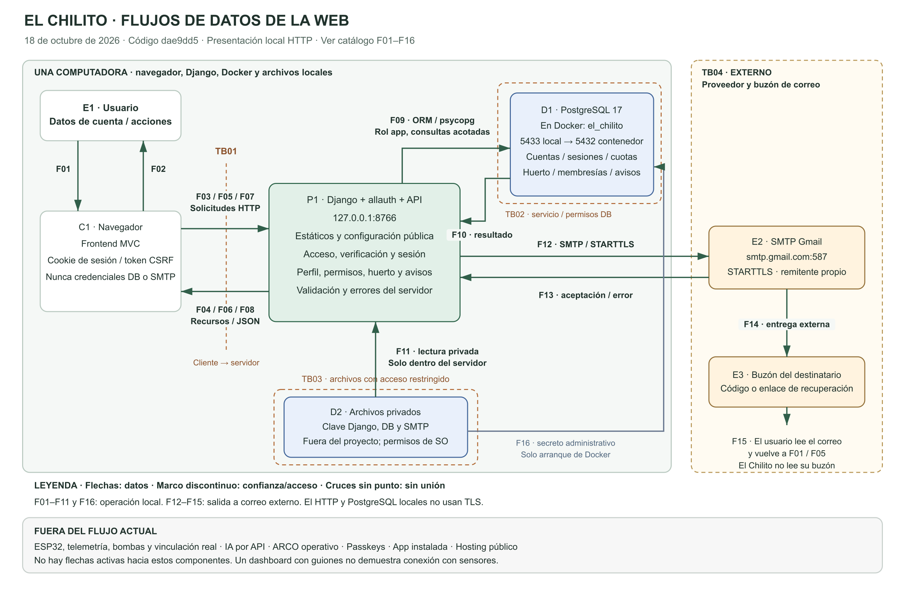
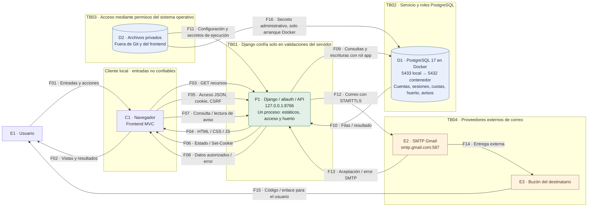

# Arquitectura, flujos de datos y límites de confianza

**El Chilito · E19-03 · 18 de octubre de 2026 · Entrega del 19 de octubre.**

**Revisión del código:** dae9dd57a32ab71688d8aa60ab1ff3ad6fdb330b. Elaboración por lectura de archivos y contratos. No se cambió la aplicación ni se ejecutaron ataques, comandos físicos o envíos de correo en esta tarea.

## 1. Qué representa

La web actual funciona en una computadora: Django sirve el frontend y la API desde http://127.0.0.1:8766; PostgreSQL 17 está en Docker, publicado solo en 127.0.0.1:5433. El correo SMTP Gmail es una integración real saliente cuando está configurada. El navegador nunca se conecta directamente a PostgreSQL ni recibe las claves DB/SMTP/Django.

El diagrama enumera actores, proceso, almacenes y flujos para identificar dónde cambia la confianza. Esta representación sirve de entrada al modelo de amenazas reducido que se realizará después; no equivale a esa evaluación ni a congelar el alcance del proyecto. OWASP describe los DFD como una forma de representar procesos, almacenes, entidades, flujos y límites; las IDs F/TB/D/P/E de este documento son convenciones propias. [Fuente: OWASP Threat Modeling](https://cheatsheetseries.owasp.org/cheatsheets/Threat_Modeling_Cheat_Sheet.html).

## 2. Diagrama listo para presentar

- [PNG para insertar en Word](diagramas/DFD-LOCAL-2026-10-18.png): exportación del diagrama, sin capturas de la aplicación.
- [Abrir SVG vectorial](diagramas/DFD-LOCAL-2026-10-18.svg): ampliable e insertable en Word compatible con SVG.
- [Fuente editable Mermaid](diagramas/DFD-LOCAL-2026-10-18.mmd). La misma fuente se muestra abajo.
- [Catálogo CSV de flechas](diagramas/FLUJOS-LOCAL-2026-10-18.csv).

En el SVG se agrupan solicitudes/respuestas entre navegador y Django para mantenerlo legible. El catálogo distingue cada dirección. Los cruces sin punto no indican conexión entre flechas. Un marco discontinuo representa una separación de confianza o permisos; Docker por sí solo no demuestra aislamiento total.

## 3. Actores, proceso y almacenes

| ID | Componente | Datos y función |
| --- | --- | --- |
| E1 | Usuario | Introduce datos y acciones y lee resultados/correo. El usuario no introduce SQL ni credenciales de infraestructura. |
| C1 | Navegador local | HTML/CSS/JS MVC y estado de vista en memoria. Envía cookies al mismo origen. El token CSRF no es el identificador de sesión. |
| P1 | Django/allauth/API | Un proceso con funciones de servir recursos, acceso y consulta del huerto. No son microservicios separados. |
| D1 | PostgreSQL Docker | Una base el_chilito: Usuario, EmailAddress de allauth, sesiones Django, cuotas, confirmación técnica local, Huerto, Zona, Membresia, Aviso y AvisoLeido. El volumen pgdata conserva los datos. |
| D2 | Archivos privados | Configuración y claves bajo %LOCALAPPDATA%/ElChilito/secrets; fuera de Git y dist. Docker usa su propio secreto administrativo al arrancar. |
| E2 | SMTP Gmail | Acepta el envío autenticado del remitente; es un proveedor externo. |
| E3 | Buzón del destinatario | Recibe el mensaje; El Chilito no accede al buzón ni conoce su contraseña. |

D1 almacena hashes de contraseña, no contraseñas de cuenta en texto plano. El código de verificación y su proceso se mantienen del lado servidor mediante las sesiones configuradas; no se dibuja una tabla propia de códigos. Los enlaces de recuperación los valida allauth; no se presupone una tabla que almacene cada enlace. No hay tablas de lecturas físicas/telemetría en la integración actual.

## 4. Catálogo de flujos

| ID | Origen → destino | Datos | Transporte / frontera | Riesgos propios |
| --- | --- | --- | --- | --- |
| F01 | E1 Usuario → C1 Navegador | Correo, contraseña, casilla, código, nueva contraseña o acción de consulta/lectura. | Interacción local de formularios; TB01 al llegar a API | R-04; R-05; R-06; R-11 |
| F02 | C1 Navegador → E1 Usuario | Vistas, errores, perfil y estructura del huerto; sin membresía solo estructura genérica. | Presentación DOM; Cliente no confiable | R-06; R-09; R-12 |
| F03 | C1 Navegador → P1 Django | GET de index.html y recursos de vista/modelo/controlador; el fragmento #ruta no viaja en HTTP. | HTTP 127.0.0.1:8766; TB01 | R-08; R-12 |
| F04 | P1 Django → C1 Navegador | HTML, CSS, JavaScript, imágenes y favicon públicos autorizados por las rutas. | HTTP, recursos estáticos del mismo origen; TB01 | R-08; R-12 |
| F05 | C1 Navegador → P1 Django | JSON de acceso/alta/código/recuperación/cambio; cookies y X-CSRFToken en mutaciones. Inspección de recuperación: X-Password-Reset-Key. | HTTP JSON del mismo origen; TB01 | R-01; R-04; R-05; R-11 |
| F06 | P1 Django → C1 Navegador | JSON de estado/configuración/errores y metadatos de verificación; Set-Cookie de sesión/CSRF según operación. No código ni clave de recuperación en respuesta. | HTTP JSON y cabeceras; TB01 | R-01; R-05; R-06; R-08; R-11 |
| F07 | C1 Navegador → P1 Django | GET de perfil/huerto/avisos y PUT de lectura con ID y cuerpo {}; cookie de sesión, y CSRF para PUT. | HTTP JSON del mismo origen; TB01 | R-01; R-02; R-03; R-04 |
| F08 | P1 Django → C1 Navegador | Perfil propio, huerto autorizado, avisos y lectura por usuario; null para mediciones. 401/403/404/503 según contrato. | HTTP JSON, respuestas privadas no-store; TB01 | R-02; R-03; R-06; R-09 |
| F09 | P1 Django → D1 PostgreSQL | Consultas y escrituras ORM/psycopg: cuentas, hashes de contraseña, verificación, sesiones, cuotas, confirmación técnica, huerto y avisos. Credenciales DB solo para autenticar conexión. | PostgreSQL TCP 127.0.0.1:5433 -> contenedor:5432, sslmode=disable; TB02 | R-01; R-05; R-07; R-08; R-11 |
| F10 | D1 PostgreSQL → P1 Django | Filas consultadas, resultados de escritura y errores de base; Django filtra y transforma antes de devolver JSON. | PostgreSQL sobre conexión local; TB02 | R-01; R-05; R-06; R-07; R-08 |
| F11 | D2 Archivos privados → P1 Django | Clave Django, contraseña del rol DB, configuración y contraseña de aplicación SMTP; se leen fuera del repositorio. | Lectura de archivos del sistema operativo; TB03 | R-08 |
| F12 | P1 Django → E2 SMTP Gmail | Autenticación del remitente con contraseña de aplicación; destinatario, asunto y correo con código o enlace de recuperación. Nunca se envía la contraseña de acceso de El Chilito. | smtp.gmail.com:587, SMTP con STARTTLS; TB04 | R-05; R-08 |
| F13 | E2 SMTP Gmail → P1 Django | Aceptación/rechazo SMTP o error de transporte, traducido a resultado/error saneado. Aceptación no garantiza recepción. | Respuesta sobre sesión SMTP; TB04 | R-06; R-08 |
| F14 | E2 SMTP Gmail → E3 Buzón del destinatario | Mensaje con código o enlace; entrega gestionada por proveedores externos. | Entrega de correo fuera del control de El Chilito; Externo al sistema | R-05; R-08 |
| F15 | E3 Buzón del destinatario → E1 Usuario | Lectura del código o apertura del enlace; el usuario vuelve a F01/F05. El servicio de correo autentica su propio buzón. | Cliente o web de correo externo; Externo al sistema | R-05 |
| F16 | D2 Archivos privados → D1 PostgreSQL | Docker monta el secreto administrativo para la inicialización/arranque del contenedor. No es la credencial del rol app ni una orden del navegador. | Archivo montado como Docker secret; TB03 / operación local | R-08 |

Los R-xx remiten al [registro interno existente](SEGURIDAD-Y-VERIFICACION-LOCAL.md#2-amenazas-y-requisitos-internos-propuestos). Es un enlace de trazabilidad; no asigna puntuaciones ni declara amenazas resueltas. R-10 corresponde a mensajes/órdenes IoT futuros y por eso no tiene flecha activa en este DFD.

## 5. Límites de confianza

| ID | Cruce | Decisión y limitación actual |
| --- | --- | --- |
| TB01 | Navegador → Django | Entradas no confiables aun en la misma PC. Django comprueba sesión, CSRF, formatos y permisos; cambiar #huerto o JavaScript no concede acceso. HTTP local sin cifrado y cookies Secure desactivadas solo en este perfil. |
| TB02 | Django → PostgreSQL | Servicio distinto y rol app limitado. ORM/psycopg y restricciones de base; migraciones con otro rol. Conexión solo local, sslmode=disable. No confundir esto con TLS ni con una base alojada en nube. |
| TB03 | Proceso → archivos privados | Permisos del sistema operativo y lectura fuera del proyecto. El operador local con privilegios sigue siendo un actor de confianza; el ciclo completo de secretos está parcial en la matriz. |
| TB04 | Aplicación → proveedor de correo | SMTP con STARTTLS al puerto 587. El remitente y contraseña de aplicación autentican el envío. La gestión posterior del mensaje y del buzón depende de proveedores y usuario; no se declara cifrado extremo a extremo. |

La cookie de sesión es HttpOnly y las API usan protección CSRF. Esas propiedades son distintas del cifrado de transporte. El framework documenta sesiones en servidor y la validación CSRF; los valores concretos y excepciones locales se comprobaron en los settings de este proyecto. [Sesiones Django 5.2](https://docs.djangoproject.com/en/5.2/topics/http/sessions/) · [CSRF Django 5.2](https://docs.djangoproject.com/en/5.2/ref/csrf/).

## 6. Recorridos que explicaremos al profesor

### A. Abrir la web y crear/verificar una cuenta

1. F03/F04 descargan la misma web desde Django. F05/F06 consultan configuración y preparan CSRF.
2. El usuario introduce correo, contraseña y casilla; el navegador envía JSON de registro. Django comprueba la autorización local, tipos, correo y validadores.
3. Se crea la cuenta y la confirmación técnica local en D1; la biblioteca mantiene el proceso pendiente. La confirmación no aprueba documentos legales ni les asigna versiones efectivas.
4. Django envía el correo por F12. F13 informa aceptación o error; no garantiza llegada a Recibidos. F14/F15 representan entrega externa y lectura por el usuario.
5. El usuario introduce el código por F01/F05; el servidor verifica proceso, caducidad e intentos. La configuración habilita sesión al confirmar el correo; el frontend vuelve a consultar sesión/perfil. No se crea membresía automáticamente.

### B. Iniciar sesión y consultar el huerto

1. Correo/contraseña viajan por F05; Django/allauth consulta D1 y autentica. El acceso habitual no envía un código en cada login.
2. F06 entrega la cookie de sesión por Set-Cookie; posteriores peticiones la adjuntan al mismo origen. JavaScript usa el CSRF correspondiente, no lee la cookie HttpOnly.
3. F07 consulta /api/cuenta y /api/huertos/actual. El servidor exige identidad, correo verificado y membresía activa para los datos del huerto.
4. Cuenta sin membresía: 403 garden-unassigned; el frontend crea una estructura genérica con guiones, sin recibir datos privados de un huerto.
5. Cuenta autorizada: F08 lleva nombres persistidos y tres zonas. Temperatura/humedad/sustrato mantienen value=null y at=null; el depósito sigue unknown. No se informa conexión física ni medición reciente.

### C. Avisos, recuperación y cierre

- Los avisos consultados proceden de D1. No hay generación automática de alarmas de cultivo sin telemetría. Si no existen, la lista es vacía.
- Marcar leído envía PUT con ID y cuerpo {}; el servidor toma el usuario de la sesión y limita el aviso al huerto autorizado. La lectura se persiste por usuario y no resuelve la condición.
- Recuperación: Django solicita envío del enlace a través de F12. Al abrirlo, el token llega inicialmente en el fragmento #restablecer?token=...; ese fragmento no se envía con el GET de index.html. El router lo conserva en memoria y limpia el fragmento. La inspección lo transmite explícitamente en X-Password-Reset-Key; el cambio lo envía en el JSON. No se registra ni se reproduce un token real en este documento.
- Logout envía DELETE de sesión con CSRF y Django invalida la sesión. Se prueba reutilización tras cierre; el ensayo específico de vencimiento continúa pendiente según la matriz.

## 7. Superficie HTTP verificada

Las rutas siguientes se contrastaron con backend/config/urls.py. Todos los endpoints pertenecen al mismo origen. Los métodos declarados se contrastaron con sus wrappers y los adaptadores del navegador.

| Método | Ruta | Condición | Datos o resultado |
| --- | --- | --- | --- |
| GET | /api/acceso/configuracion | Pública | Política, estado legal y cookie CSRF. No entrega credenciales. |
| POST | /_allauth/browser/v1/auth/signup | Excepción local explícita + CSRF | email, password, termsAccepted booleano; crea confirmación técnica y proceso de verificación. |
| POST | /_allauth/browser/v1/auth/login | CSRF y límites | email y password; sesión o proceso pendiente de verificar. |
| GET | /_allauth/browser/v1/auth/session | Cookie si existe | Estado de sesión de navegador; no token de aplicación. |
| DELETE | /_allauth/browser/v1/auth/session | CSRF | Cierra la sesión servidor. |
| GET | /api/acceso/verificacion | Proceso pendiente | Correo y expiresAt; no devuelve código. |
| POST | /_allauth/browser/v1/auth/email/verify | Proceso pendiente + CSRF | key contiene el código introducido; valida, no concede membresía. |
| POST | /_allauth/browser/v1/auth/email/verify/resend | Proceso pendiente + CSRF y límites | Cuerpo {}; nuevo envío si está permitido. |
| POST | /_allauth/browser/v1/auth/password/request | CSRF y límites | email; respuesta neutral para cuenta desconocida si el correo está disponible. |
| GET | /_allauth/browser/v1/auth/password/reset | Clave de enlace | X-Password-Reset-Key para inspeccionar validez; no realiza el cambio. |
| POST | /_allauth/browser/v1/auth/password/reset | Clave de enlace + CSRF | key y password; no inicia sesión automáticamente. |
| POST | /_allauth/browser/v1/account/password/change | Sesión verificada + CSRF | current_password y new_password; valida contraseña actual. |
| GET | /api/cuenta | Cuenta activa, autenticada y correo verificado | Perfil propio y gardenAssigned; no el usuario elegido por query string. |
| GET | /api/huertos/actual | Sesión, verificación y membresía activa | Huerto principal y tres zonas; mediciones nulas. |
| GET | /api/huertos/actual/avisos | Mismo permiso del huerto | Lista persistida; vacía no significa fallo del servicio. |
| GET | /api/huertos/actual/avisos/<str:notice_id> | Permiso por huerto y objeto | Detalle autorizado o 404 neutral. |
| PUT | /api/huertos/actual/avisos/<str:notice_id>/lectura | Permiso por objeto + CSRF | Cuerpo {}; marca leído para request.user y no resuelve la condición. |

Los estados HTTP dependen del flujo: una verificación pendiente puede usar 401 y un cierre exitoso puede dejar estado anónimo 401 según allauth. No se debe interpretar cada 401 como fallo técnico. Las consultas de huerto distinguen falta de sesión, verificación/membresía, objeto no disponible y servicio no disponible. Ver [contratos](CONTRATOS-INTEGRACION-LOCAL.md).

## 8. Operación local separada del navegador

- El operador ejecuta preparar_equipo.ps1 e iniciar_aplicacion.ps1: Docker inicia PostgreSQL y Python inicia Django. El arranque habitual no aplica migraciones.
- Las migraciones son una operación explícita con rol el_chilito_migrador; el proceso web usa el_chilito_app. El usuario de la web no obtiene esos roles.
- La membresía se asigna administrativamente mediante manage.py asignar_huerto. No existe endpoint público de asignación ni de vinculación real; registrar cuenta no lo sustituye.
- GitHub Actions ejecuta sus propios servicios/base y correo en memoria; no consulta la base principal de Rafael ni envía Gmail. El CI no forma parte del recorrido de una petición de usuario.
- Respaldos, restauración y registro de eventos son operaciones relacionadas, no flujos del navegador hacia la DB. Su revisión no queda certificada por dibujar este esquema.

## 9. Elementos futuros y limitaciones

| Elemento | Estado y consecuencia para el DFD |
| --- | --- |
| ESP32, tres sondas, DHT22 y nivel de agua | Referencia del producto físico; ingesta, identidad del dispositivo y mensajes siguen sin implementar. No hay flecha de sensores hacia D1. |
| Bombas/lámpara y órdenes | Sin API de actuación ni confirmación física; la web no riega ni demuestra encendido. |
| Vincular mi huerto | Diálogo visual; no transmite código de vinculación ni concede permisos. |
| IA, ARCO y passkeys | Interfaces o accesos preparados; sin servicios operativos integrados en el flujo actual. |
| Cliente móvil instalado | Pendiente; vista adaptable no equivale a segundo cliente entregado. |
| Hosting, dominio y HTTPS público | Futuro; este diagrama no especifica proveedor ni topología de producción. |

Estos límites describen el código observado; el alcance congelado se acordará en su tarea posterior. La clasificación de riesgos y su tratamiento se completarán en el modelo de amenazas reducido.

## 10. Evidencia de esta revisión

- [Registro de fuentes, huellas y comprobaciones](EVIDENCIA-FLUJOS-2026-10-18.json). Se validaron 16 IDs, correspondencia entre catálogo/Mermaid/SVG, existencia de fuentes y rutas; no son pruebas de seguridad nuevas.
- [Matriz ASVS y resultados existentes](MATRIZ-REQUISITOS-Y-EVIDENCIAS-2026-10-18.md).
- Fuente primaria de cada flecha:
- F01: [dist/controlador/acceso.js](https://github.com/rafael56cetz/ProyectoWEBCHILITO/blob/dae9dd57a32ab71688d8aa60ab1ff3ad6fdb330b/dist/controlador/acceso.js).
- F02: [dist/vista/aplicacion.js](https://github.com/rafael56cetz/ProyectoWEBCHILITO/blob/dae9dd57a32ab71688d8aa60ab1ff3ad6fdb330b/dist/vista/aplicacion.js).
- F03: [backend/config/urls.py](https://github.com/rafael56cetz/ProyectoWEBCHILITO/blob/dae9dd57a32ab71688d8aa60ab1ff3ad6fdb330b/backend/config/urls.py).
- F04: [backend/config/views.py](https://github.com/rafael56cetz/ProyectoWEBCHILITO/blob/dae9dd57a32ab71688d8aa60ab1ff3ad6fdb330b/backend/config/views.py).
- F05: [dist/modelo/servicio-acceso.js](https://github.com/rafael56cetz/ProyectoWEBCHILITO/blob/dae9dd57a32ab71688d8aa60ab1ff3ad6fdb330b/dist/modelo/servicio-acceso.js).
- F06: [backend/cuentas/api.py](https://github.com/rafael56cetz/ProyectoWEBCHILITO/blob/dae9dd57a32ab71688d8aa60ab1ff3ad6fdb330b/backend/cuentas/api.py).
- F07: [dist/modelo/servicio-aplicacion.js](https://github.com/rafael56cetz/ProyectoWEBCHILITO/blob/dae9dd57a32ab71688d8aa60ab1ff3ad6fdb330b/dist/modelo/servicio-aplicacion.js).
- F08: [backend/huerto/api.py](https://github.com/rafael56cetz/ProyectoWEBCHILITO/blob/dae9dd57a32ab71688d8aa60ab1ff3ad6fdb330b/backend/huerto/api.py).
- F09: [backend/config/settings/local.py](https://github.com/rafael56cetz/ProyectoWEBCHILITO/blob/dae9dd57a32ab71688d8aa60ab1ff3ad6fdb330b/backend/config/settings/local.py).
- F10: [backend/huerto/services.py](https://github.com/rafael56cetz/ProyectoWEBCHILITO/blob/dae9dd57a32ab71688d8aa60ab1ff3ad6fdb330b/backend/huerto/services.py).
- F11: [backend/config/private.py](https://github.com/rafael56cetz/ProyectoWEBCHILITO/blob/dae9dd57a32ab71688d8aa60ab1ff3ad6fdb330b/backend/config/private.py).
- F12: [backend/cuentas/email.py](https://github.com/rafael56cetz/ProyectoWEBCHILITO/blob/dae9dd57a32ab71688d8aa60ab1ff3ad6fdb330b/backend/cuentas/email.py).
- F13: [backend/cuentas/email.py](https://github.com/rafael56cetz/ProyectoWEBCHILITO/blob/dae9dd57a32ab71688d8aa60ab1ff3ad6fdb330b/backend/cuentas/email.py).
- F14: [backend/cuentas/email.py](https://github.com/rafael56cetz/ProyectoWEBCHILITO/blob/dae9dd57a32ab71688d8aa60ab1ff3ad6fdb330b/backend/cuentas/email.py).
- F15: [backend/config/settings/local.py](https://github.com/rafael56cetz/ProyectoWEBCHILITO/blob/dae9dd57a32ab71688d8aa60ab1ff3ad6fdb330b/backend/config/settings/local.py).
- F16: [compose.yaml](https://github.com/rafael56cetz/ProyectoWEBCHILITO/blob/dae9dd57a32ab71688d8aa60ab1ff3ad6fdb330b/compose.yaml).

La explicación de SMTP distingue envío y entrega. La documentación oficial de Django describe el backend SMTP y los backends de prueba; el servidor concreto, STARTTLS y las restricciones observadas proceden de cuentas/email.py. [Django 5.2: correo](https://docs.djangoproject.com/en/5.2/topics/email/).

**Responsabilidad documental:** Rafael y equipo; revisión humana prevista de Kevin y Carolina pendiente de confirmación. No se modificaron asignaciones ni se declara auditoría o certificación de todo el sistema.
